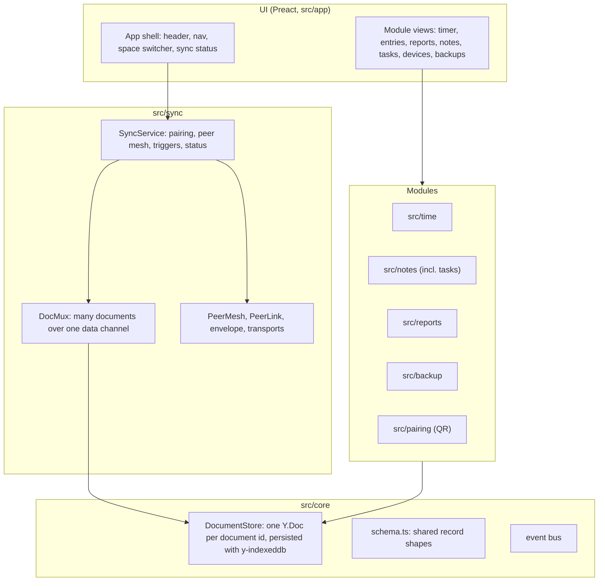

# Architecture

How the code is laid out and what each module may rely on.
Why: `goals.md` and `decisions/`. Sync in detail: `sync.md`.

## Pages

| Path | What |
| --- | --- |
| `/` | The app (`index.html`, `src/app/main.tsx`) |
| `/probe` | The capability probe (`probe.html`, `src/main.ts`) |

The app uses hash routes (`#/time`, `#/notes/…`), so the static host needs no routing rules.

Navigation is built from the registered views (`src/app/nav.ts`, `Nav.tsx`):

- A view's `group` (the shell's `NAV_GROUPS` owns the list; today only `settings`) groups it; no `group` makes it a tab of its own. A group with one visible page shows as that page; a non-landing group with several pages would render as a menu (`GroupTab`), though none exists.
- `TopNav` renders `navModel(views, route)` at the top on every screen size: tabs Home · Time · Notes · Tasks · Settings. Each tab has an icon (`ViewDef.icon`, drawings in `ui/icons.tsx`; the Settings group's icon is in `Nav.tsx`) and a label that is hidden visually, not removed, under about 560 px. A tab can carry a text pill (F-74): `registerTabBadge` for a module's own and the shell's rule (`tab-badges.ts`: amber "!" for a `reportHealth` warning, a count for requests and merges worth a look) put it on Settings. What's new is a separate "New" chip by the logo (header item, `src/help/HelpButton.tsx`).
- The header (`App.tsx`), left to right: the logo and `APP_NAME` (a link to the first tab; the name hides under about 440 px), the tabs, then `.topbar-end` with the registered header items (`registerHeaderItem`: the timer pill from `src/time/HeaderTimer.tsx`, then the command-palette button from `views/CommandHost.tsx`; while a timer runs `.topbar-end` is `display: contents` (always under 58 rem, by `:has(.timer-pill.running)` above) so the running pill takes its own full-width row at every width (H-59); from 360 px the tab icons share row one with the logo, command and sync, so the header is one row idle and two running, and below 360 px the tabs keep their own row) and the sync status control (`SyncStatus.tsx`). The sync control's shape comes from `syncShape` in `sync-state.ts` (off, direct, relay, offline); its popover lists the other devices (names from the account document, links from `SyncStatus.peers`) and, under "Other", what modules report through `core/health.ts`. Help has no header button: it is reached from Settings (About & help), the palette and the welcome screen (a header item with `where: 'welcome'`). Test builds can show any status with `window.__app.fakeStatus`.
- Home (`src/home/`, `#/home`, F-33p) is the first tab and the landing page while its Features switch is on. It renders the cards modules add with `registerHomeCard` (`src/app/home-cards.tsx`): Needs you from `src/settings`, This week and Where the week went from `src/reports`, Due soon and Recent notes from `src/notes`.
- The Time page is the log: it has no start bar (the timer is the header pill, F-33j) and a primary "Add entry" action in its page header (`ManualEntryDialog.tsx`, passed through `TimerPageHeader`'s `primary`). The view id and the stored `timer-view` key keep the old name (F39). It has a List | Week | Reports switch (`#/time/list`, `#/time/week`, `#/time/reports[/<section>]`; the last view is kept in `localStorage`, `timer-view`). The shell draws it (`views/TimerPageHeader.tsx`, `timer-views.ts`): the timer view lists its `modes`, and a view with `joins: 'timer'` (Reports) becomes a further segment instead of a tab; `App.tsx` renders it at `#/time/<path>`, `legacyRoute` sends the old `#/reports*` there and `hiddenRoute` sends it to `#/time` when Features hides it. The one space filter (`space-filter.tsx`) sits in the same header for all views (R-335), behind a `FiltersButton` (F-33v) and only with two or more spaces. The List view has no total cards: each day header holds its total (F-33w). `#/entries` is a hidden view in `src/time/index.ts` that redirects to Week; Projects, clients, tags and task values are the Organize section of Settings and links, files, daily notes and Mirror the Notes section (`#/settings/organize`, `#/settings/notes[/<row>]`): pickers' "Edit…", the palette and the ⚙ on Notes open them. Modules add parts to Notes with `registerSection` (`src/app/sections.ts`, rendered by `views/Sections.tsx`); the Organize body is `src/time/ProjectsView.tsx`.
- Settings (`src/settings/SettingsView.tsx`, a `landing` group in `NAV_GROUPS`, F-326, F-33s) is one long single-column page at `#/settings` with a contents row of chips under the title (an amber dot only where something needs attention) and these sections in order: Needs you (only while something waits), Backups, Version history, Recently deleted, Passphrase and import, Devices and sync, Spaces, Sharing, Organize, Notes (hidden while Notes is off; rows `links`, `files`, `periodic`, `mirror`), Display, Features, Help, Advanced. `#/settings/<section>` (slugs in `SETTINGS_SECTIONS`, `nav.ts`) scrolls to one; `#/settings/<section>/<row id>` also opens a row (`this` or a device id, a space id, an account fingerprint). Every status line is always shown (Sync in Devices and sync; Passphrase and Import in Passphrase and import; `DataLines.tsx`). Backups, Version history and the Manage fold of the passphrase are parts the modules add (`registerSettingsPart`, sections `backups`, `version-history`, `passphrase`); a fold (`OpenDetails`) opens when the address has a third segment (`#/settings/backups/open`, `#/settings/version-history/<time>`, `#/settings/passphrase/manage`).
  - Devices (`DevicesSection.tsx`), spaces (`SpacesSection.tsx`) and accounts (`SharingSection.tsx`) are rows that open in place (`OpenRow.tsx`, one open per section). A row holds toggle chips for what it keeps (`KeepChip`: a checkbox in a pill; the device row and the space row write the same `keeps` record), Rename, Archive, Remove, Leave, End share. Detail routes remain only for Add a device (`#/settings/devices[/add]`, `src/devices/AddDeviceView.tsx`) and Import (`#/settings/import`); `#/settings/network` is a hidden view.
  - Needs you comes from `src/app/needs.ts`: a join request waiting on this device (`invites.ts` reports into `setPendingJoins`, so the shell loads no invite code), a share request waiting (`shareLinks.hosting`), and what modules add with `registerNeed` (Backup: "No backup yet"). The Settings tab badge (`tab-badges.ts`) is a count for a request and an amber "!" for a health warning.
  - Modules add pieces to Devices and Advanced with `registerSettingsPart` (`src/app/settings-parts.ts`): the devices module adds the notices under the Sync line and, in Advanced, device keys and ids, the connection (relay, STUN, logs) and Reset this device's data (`src/devices/parts.tsx`). Advanced renders its parts only while open.
  - One-time code A+ (F-33t): `AddDevicePanel` shows the QR code and a link (`joinLink`, `#/join/<code>[/<server>]`, `src/qr/payload.ts`) with Send link (`navigator.share`, feature-detected) and Copy link, then the code in groups with Copy code; `JoinCodeInput` accepts a pasted link or QR text. `legacyRoute` sends `#/join/<code>` to Add a device; Welcome reads it itself.
  - "Share…" opens `ShareSheet.tsx` (a Sheet or Dialog around `SharePanel`); the passphrase sheet opens on top when making the link needs it.
  - Old routes redirect (`legacyRoute` in `nav.ts`, used by `App.tsx`): `#/manage/<x>`, `#/<x>`, `#/settings/space/<id>` (to `spaces/<id>`), `#/settings/account/<fp>` (to `sharing/<fp>`), `#/settings/devices/<id>` (to `devices-sync/<id>`) and the folded pages (General, Security, Features, Spaces, Sharing: their section); `#/backup`, `#/backups` and `#/settings/backup` open `#/settings/backups` (`#/settings/backup/passphrase` the passphrase Manage fold), `#/history` and `#/settings/history` open `#/settings/version-history`; the hidden view `#/backup` is the welcome screen's restore page; pages that left Settings go to their place: Projects & tags and Organize (`#/settings/organize`, a section of Settings, F-33x), Note settings and Mirror (`#/note-settings`, `#/mirror`: `#/settings/notes[/mirror]`, F-55), Shortcuts (`#/help/shortcuts`).
- Features (`src/app/features.ts`, Settings › Features): the per-device list `hidden_modules` in `localStorage` (absent: all on) hides Time (Reports is a segment of the Time page and follows it; it has no switch of its own), Notes, Tasks, Mirror and Import. `allViews()`, `allCommands()` and `allSearchSources()` apply it, so nav, Settings pages, the palette, shortcuts and search follow; `registeredViews()` is the unfiltered list.
  A hidden page's route goes to the first visible tab (`landingRoute` in `features.ts`; Settings when every other feature is off, as after a join and on `#/`), used by `App.tsx` and `join.ts`.
  The switches are independent (F-33n): Notes off keeps Tasks, which open on their own route `#/tasks/<id>` (`TaskDetail.tsx`: the same `NoteEditor`, Properties and history as a note, no tree; with Notes on `#/tasks/<id>` goes to `#/notes/<id>`), and an old `#/notes/<task>` follows it there (`registerHiddenRedirect` in `registry.ts`, registered by `src/notes/index.ts`; any other hidden note goes to `landingRoute`).
  With Notes off, a `[[link]]` in a task body to another task opens it, to a plain note is inert text titled "Turn on Notes to open this note" (`linkTitle` option of the editor), the table lists tasks only, and the notes commands, note settings and plain-note search results are hidden.
  Tasks off keeps Notes, where task notes stay plain notes with their front matter.
  Time hidden also hides Reports, the header pill, the timer commands and Alt+S, the title/favicon/badge cue and the tasks' timer buttons (data keeps syncing).
  A running timer blocks hiding Time (`setFeatureBlock`, set by the cue in `src/time/TimerCue.tsx`; Settings disables the switch and says why).
  Settings, Devices and sync status are never hidden.
  Welcome's two presets write the list.
  The passphrase is asked for in one sheet (`withKey` in `src/app/key-prompt.ts`; `PassphraseSheet` loads when first needed, `PassphraseInput` has the Show switch and live hint); the Manage fold of the Passphrase section (`src/backup/PassphraseSection.tsx`) only shows its state and forgets it on this device.
- Help & About (`src/help/`, `#/help[/<section>]`, opened from Settings (About & help), the palette and the welcome header) is one long page: a table of contents, then About, What Yak stands for and the user guide (Markdown in `docs/user/*.md`, bundled with Vite `?raw`, rendered by `src/help/markdown.ts`); the shortcuts section is the editable `ShortcutsCard`. A section needs a file and an entry in `ORDER` (`topics.ts`). What's new comes from one file per entry in `docs/user/changes/` (`YYYY-MM-DD-HHMM-<slug>.md`, UTC; other names are ignored) plus the archive `docs/user/changes.md`, gathered with `import.meta.glob` and merged by `mergeChanges` in `changes.ts` (newest date first; same date: fragments before the archive, file names descending) (newest entries, a dot on the Settings tab until seen, per device in `localStorage`); a one-time alpha notice is a banner in `src/help/`. Open source credits (`licenses.json`) come from `src/licenses/`, see F-209. Report a problem is its own page, `#/help/report`.
- The palette lists a Settings group (`settings-index.ts`, `paletteCommands()`): sections and rows by title plus keywords (`CommandDef.keywords`), opening `#/settings/<section>[/<row>]`; entries follow Features. Add a row there when a setting is added.
- Grouped pages are still routable and in the command palette. A new page needs only `group` in its `registerView` call.

A service worker (`/sw.js`, scope `/`, production builds only) makes both pages work offline after one visit; it is generated at build time from `src/offline/`.
It never answers `/signal/*`, `/probe/*` or cross-origin requests.
Details and the kill switch: `offline.md`.

## Layers



Modules talk to each other only through the documents and the event bus, as the plan requires.
A module never imports another feature module.

## Documents and spaces

- A **document id** is a path-like string: `account/<accountId>` for the account, `space/<spaceId>` for a space's shared part, `space/<spaceId>/private` for its private part. Space ids are random (24 hex characters); names live in the account document (`src/core/account.ts`). The account id is the fingerprint of the account key (S-76a); a moved account keeps its old id (`legacyId`) while older builds may use it: `src/core/account-move.ts` copies and bridges the two account documents, and `allowsDoc` answers to both ids.
- `src/app/account-state.ts` keeps the open space documents in step with the account's space list; `useApp()` gives `account`, `accountId`, `spaces`, and per space `spaceDocs`/`doc` (shared) and `privateDocs`/`privateDoc` (private).
- The **private part** holds `time_entries` and `project_rates` (`<projectId>:rate`, `<projectId>:currency`; `src/core/rates.ts`). It syncs only to the account's devices.
- Old first-layout databases (`app-doc-space/personal`, `…/work`, `…/time`) may remain on a device; nothing reads them.
- Browser tests keep the readable first-layout names: in `?test` mode the hooks translate `space/personal` and `space/work/time` to the real documents (`src/core/test-ids.ts`).
- A space's log document (`space/<id>/log`; synced only between devices that keep the space, never backed up) also holds the `cover` map (B-83, `src/backup/cover.ts`): per device, what its latest backup held of the space, as state vectors. `useBackupHealth` (`runtime.ts`) reads it so another device's recent backup can stand in for this device's own.
- More documents per space later use ids under the space, for example `space/work/notes/<uuid>`; the store, the sync multiplexer and backups already handle any id.
- `DocumentStore.open(id)` returns the `Y.Doc`, loaded from IndexedDB (`app-doc-<id>`); every opened document is synced with every paired device.

## Record shapes

Every record lives in a `Y.Map` keyed by a **fresh UUID** created by the device that creates the record.
Never create a record under a key another device could also create: two concurrent creations of the same key keep one record whole and drop the other (found by the merge fuzz test).
Deletes are soft (`deleted: true`) and permanent. The one exception: a time entry stamped with `deleted_at` can be restored by the user for 45 days (`restoreEntry`; the window is `RESTORE_WINDOW_DAYS` in `src/time/entries.ts`); after that it stays deleted.
Field names follow the Toggl API v9 where a Toggl equivalent exists.

Each space's shared part holds every map below except `time_entries`, which lives in its private part (and project rates, which the private part overrides):

| Map | Value fields |
| --- | --- |
| `time_entries` | `start` (ISO 8601 string), `stop` (ISO string or `null` while running), `duration` (seconds, `0` while running), `description`, `project_id` (UUID or `null`), `task_id` (note UUID or `null`), `tags` (array of tag names), `billable`, `device_id`, `created_at`, `updated_at`, `deleted`, `deleted_at` (ISO string or `null`; set by a delete, cleared by a restore; absent on older entries), and `import_id` (optional: set only by the Toggl import, a fingerprint of start, stop, description, project and client) |
| `projects` | `name`, `client_id`, `color` (`#rrggbb`), `billable`, `rate` (number or `null`), `currency` (`USD` default), `active`, `created_at`, `updated_at`, `deleted` |
| `clients` | `name`, `archived`, `created_at`, `updated_at`, `deleted` |
| `tags` | `name`, `created_at`, `deleted` |
| `notes` | `path` (for example `Projects/Acme.md`), `text` (`Y.Text`, full Markdown including YAML front matter), `created_at`, `updated_at`, `deleted` |
| `folders` | Folders kept with no note in them: key = folder path, value `true` (or `false` once deleted), plain values so two devices never lose each other's entry. A folder that has notes needs no entry |
| `meta` | `schema_version` (1), `created_at` |

The account document holds `account` (`id`, `created_at`), `spaces` (`<spaceId>:name`, `<spaceId>:created_at`), `devices` (`<deviceId>:name`, `<deviceId>:removed`, `<deviceId>:left`; see `src/core/devices.ts`), `keeps` (`<deviceId>:<spaceId>` → true or false: which spaces each device keeps; see `src/core/keeps.ts`), `keys` (`account:<fingerprint>` public account keys, `sealed:<fingerprint>` the private key sealed with a key from the passphrase, never stored, `device:<deviceId>` the device's public keys and what its build understands (`v`), `cert:<deviceId>` certificates (version 2: an owner's approval), `required` the signed one-way switch, `chosen`, `grant:`/`established:` space keys (epoch 1), and `removal:` signed removals; records of older builds (`handover:`, `epoch:`, `epoch-at:`, `mesh` grants) are ignored; `src/core/account-keys.ts`, `key-certs.ts`, `key-grants.ts`, `key-removals.ts`, `key-switch.ts`; the trust sync reads is worked out in `src/app/key-trust.ts` for the app and the Obsidian plugin; one-time invites in `src/sync/invite.ts`; private halves in `src/sync/key-store.ts`), `spaces` also holds `<spaceId>:share` (the owner a shared space trusts); `bookmarks` (`<spaceId>:<noteId>` → true or false; `src/notes/bookmarks.ts`) and `settings`: `week_start` (`monday`), `hours_format` (`decimal`). All values are plain and keyed per field, so concurrent edits of different fields never drop each other.
Device-only settings (signaling server, backup folder handle) never go into a document.

**Running timer rule:** at most one entry with `stop === null` across all of a person's devices.
When sync brings in a second running entry, the one with the earlier `start` is stopped at the later one's `start`.
The rule is applied deterministically on every device whenever `time_entries` changes, so all devices reach the same result.

**Tasks are notes** whose front matter marks them as tasks, compatible with the TaskNotes convention (`tags` contains `task`; `status`, `priority`, `due`, `scheduled`, `contexts`, `projects`, `timeEstimate`).
Kanban and table views read and write front matter fields; the note text stays the single source of truth.

## Module contract

```ts
// src/<module>/index.ts
import { registerView } from '../app/registry';
registerView({ id: 'timer', title: 'Time', path: 'time', order: 10, component: TimerView });
```

- `src/app/modules.ts` imports each module's `index.ts`; adding a module is one line there.
- Besides views, `registry.ts` has four shell slots: `registerGlobal` (always mounted, above the navigation), `registerBanner` (above the view), `registerHeaderItem` (a compact control in the header, such as the running timer) and `registerTabBadge` (a dot on a tab).
- The sync popover in the header (`SyncStatus.tsx`) lists what modules report through `src/core/health.ts` (`reportHealth`, read with `useHealth()`) under "Other", and the Settings tab shows an amber "!" when one is a warning; the backup banner component reports the backup state.
- A view gets everything through `useApp()` (`src/app/context.tsx`): the store, the active space id and its `Y.Doc`, the device id, the sync service.
- Re-render on document changes with `useYVersion(yType)` (`src/app/hooks.ts`), which observes deeply and returns a counter.
- Write with `doc.transact(() => …)`; one user action is one transaction.
- First-load budget (`scripts/check-bundle.mjs`, F-85): a module's `index.ts` registers eagerly and cheaply; the code behind a view, a Home card or a Settings part loads on first open through `lazyView` / `lazyComponent` (`src/app/lazy.tsx`). Eager: the shell, the header items, the Time page and its timer, the Home page with the Needs card, the sync and backup runtimes, banners and the data other code reads at start (`note-store`, `tasks`, search and tag sources). Lazy: Notes, Tasks, Reports, Settings and its Organize part, Import, Backup & restore, Add a device and the QR code, Help and the bundled guide (the "New" chip loads `help/topics` after the first paint), Mirror. A lazy view imports the CSS only it uses (`notes.css`, `reports.css`, `import.css`); rules other code also relies on stay in the first-load CSS (`notes/shared.css`). Do not import a feature's barrel (`../qr`) from eager code; import the file you need. Every chunk is in the service worker's precache (`src/offline/build-plugin.ts` lists all of `dist/`), so a lazy view opens offline after one visit.

## Sync

- `SyncService` (`src/sync/sync-service.ts`): pairing, the peer mesh, reconnect triggers. `DocMux` runs one Yjs sync per document over one data channel. `allowsDoc` (`src/app/sync-filter.ts`) decides which documents go to which device. `Tabs` (`src/sync/tabs.ts`) lets one tab per browser profile run sync; other tabs go through it.
- Files (`src/sync/file-transfer.ts`, S-268): pull-based, in 60 KiB verified pieces, on direct links only; `createFileHost` (`src/app/file-host.ts`) lists the indexed files this device lacks, and the filter is `allowsDoc` for `space/<unit>`.
- Details: `sync.md`.

## Sharing between accounts

- A **share** is a space (S-259b). Its shared document holds a `share` map: the owner-signed `share`, `member:<fp>` and `end:<fp>:<n>` records, copies of each member account's approved `cert:`/`removal:` records, and cosmetic `name:` entries (`src/core/shares.ts`). The private part, the log and the account document never leave their account.
- An account trusts a share's owner only through `spaces.<S>:share` (the owner's fingerprint) in its own account document; ends and removals seen are pinned in `localStorage` (`share-pins`).
- `src/app/shares-runtime.ts` reads each roster, keeps a `ShareTrust` (`share-trust.ts`), makes this device copy its own account's records into the roster, and runs one `SyncService` per share (`storageKey` `…-share-<S>`) while this account is an active member. `allowsShareDoc` (`sync-filter.ts`) lets `space/<S>` through to a verified peer and nothing else. The account mesh is unchanged; Obsidian runs none.
- Joining: `src/sync/share-link.ts` (one account, 15 minutes, compared code; the sealed-message helpers are in `sealed-mailbox.ts`, shared with invites) and `src/app/share-links.ts`. UI: `src/app/views/SharePanel.tsx` (the share flow on a space's page and in the share sheet) and `ShareJoin.tsx` (`#/share/<code>`). Settings shows shares by account (F-334): `src/app/accounts.ts` groups the roster views into other accounts; your label for an account (`account_label:<fp>`) and when a share began (`share_since:<space>:<fp>`) live in the account document's `settings` map (`src/core/account-labels.ts`; unset reads as empty, no migration), never in a roster.
- Details and limits: `decisions/sync.md` S-259 to S-259g; the Settings views are `decisions/settings.md` F-334.

## Commands and shortcuts

- Modules register commands (`registerCommand`, `src/app/commands.ts`): id, title, default shortcuts, `run({ app })`. Every view gets a "Go to …" command.
- One key handler and the palette (Alt+P): `src/app/views/CommandHost.tsx`. Keys an editor already handled are left alone.
- Overrides live in the account document's `shortcuts` map. Daily, weekly and monthly note settings: `src/core/templates.ts`.

## History

- Data migrations (F39, F-261): `src/core/migrations.ts` holds the step lists (`DOC_MIGRATIONS`, `DEVICE_MIGRATIONS`) and the runner; `DocumentStore.open` runs document steps before sync sees the document, `main.tsx` runs device steps first. Add a step at the end of the list; test it with `migrationConverges`.
- `src/core/history/`: change log (`recorder.ts`, IndexedDB `idb-store.ts`), time travel and restore (`travel.ts`), days and points (`browse.ts`), thinning, the bulk-change watch.
- `src/history/`: the Version history section of Settings (`HistoryPart`, `HistorySection`, the warning thresholds `HistoryCard`), the warning banner, the recorder host (one writer tab).
- Note versions: `src/notes/views/NoteHistory.tsx`.

## Mirror

- `src/mirror/` keeps the notes of spaces and a folder of Markdown files in step both ways. Adapters: the browser folder (below) and the Obsidian vault (below).
- `MirrorFs` (`fs.ts`): `list` (notes, and the files in `<Space>/attachments/`), `read`, `write`, `readBinary`, `writeBinary`, `delete`, `rename`. `MemoryFs` is the test double.
- Files (`files.ts`, N-269): after the notes of a space, `syncFiles` compares `<Space>/attachments/` with the `attachments` index and the space's blob store, by SHA-256 and per-path stamps (`MirrorState.files`).
- `syncMirror(fs, spaces, state)` (`engine.ts`) is one pass over every space. `MirrorState` is plain JSON that the caller stores between passes: per note, the path, text and stamp both sides last agreed on.
- One folder per space (`folderName`). A note's text is the file, so task front matter is untouched.
- Outside edit: applied with `minimalEdit`, so a concurrent edit elsewhere in the note still merges.
- Renames and moves: note path to file rename; a vanished file whose text reappears at one new path is a move.
- Deletes: follow unless the other side edited, then the edit survives.
- Both sides edited: the file's version becomes a conflict copy (`Name (conflict).md`, a new note and file); the note's text stays at the original path.
- Changes the mirror makes to notes carry the transaction origin `MIRROR_ORIGIN`.
- Browser folder (Chrome, Edge): `HandleFs` (`handle-fs.ts`) over a File System Access directory handle; `BrowserFolder` (`folder.ts`) keeps the handle in IndexedDB (`device-db.ts`), like backups.
- `MirrorService` (`service.ts`) runs one pass at a time (a Web Lock across tabs). Triggers: a local change to a mirrored space's notes (debounced, mirror's own changes ignored), a 4 s timer while visible, the page becoming visible, File System Observer where it exists.
- Device-only state: folder handle, spaces left out, `MirrorState`, undismissed conflicts. Never in a document.
- UI: the Mirror section of the note settings page (`MirrorView.tsx`; without `showDirectoryPicker` it says it is not available) and a banner when folder access is lost.
- Decisions: `decisions/mirror.md`.

## Obsidian plugin

- `obsidian/` builds `main.js` (CommonJS, `npm run build:obsidian`) from this repo's `src/core`, `src/sync`, `src/mirror` and `src/app/account-state.ts`. The Obsidian API is declared in `obsidian/src/obsidian.d.ts`, not imported.
- The vault is a device of the account with its own `keeps`. Documents are saved as files in the plugin folder (`doc-persist.ts`); a space's private part is never held.
- `VaultFs` (`vault-fs.ts`) is a `MirrorFs` over `<root>/` (default `Yak/`) and translates cross-space links (`links.ts`, `relink.ts`). `VaultPort` (`vault-port.ts`) is the vault API it needs; `vault-obsidian.ts` is the real one, `MemoryVault` the test double.
- `analyzeVault` (`vault-rules.ts`) runs before each pass: notices for root notes and stray folders, renamed space folders named back, deleted ones hold the space and ask.
- Decisions: `decisions/obsidian.md`. Install and release: `obsidian/README.md`.

## Files in notes

- Bytes: `src/core/blobs/store.ts`, IndexedDB `app-blobs-<spaceId>`, keyed by SHA-256, outside Yjs (history never shrinks). Index: the `attachments` map in the space document (`attachments.ts`; absent reads as empty). `host.ts` is what the editor uses. Limits in `limits.ts` (N-166b).
- Display: `![[name.ext]]` renders in Live mode (`EmbedWidget` in `src/notes/editor.ts`): inline only if the bytes sniff as PNG/JPEG/WebP/GIF, otherwise a chip with a download. SVG and HTML are never inline (blob URLs share the app's origin). `public/_headers` allows `img-src blob:`. Decisions N-166a–f.
- Transfer (`src/sync/file-transfer.ts`, S-268): pull by need over direct links only, 60 KiB pieces checked against the index's `pieces`, resumable, spread over every direct peer that has the file. Every device that keeps the space fetches every file in the background. The relay never carries a file.
  - Account mesh: the file rule is the document rule (`createFileHost` in `src/app/file-host.ts`, `allowDocFor`).
  - Share mesh: files of the shared space only, to the verified peers of active member accounts (`allowsShareFile`, S-272).
- Moving a note to another space copies the files it names (`copyIndexEntry`/`copyBlobs` in `src/core/blobs/copy.ts`, called from `moveToSpace`; N-272). The source keeps its files.
- Mirror and Obsidian (`src/mirror/files.ts`, N-269): one `attachments/` folder per space, compared by hash.
- Backups (`src/backup/blobs.ts`, B-270): folder backups and the zip include files by hash; the JSON download does not.
- Deleting: never automatic. Settings lists unused files; a delete marks the index entry and every device drops the bytes (`src/core/blobs/unused.ts`, N-271).

## Links between notes

- `[[links]]` resolve like Obsidian (`makeResolver`, `src/notes/links.ts`).
- Renames and moves rewrite links that reach the moved notes (`src/notes/link-update.ts`); setting `link_update`: auto (default), ask, off.

## Styling

- `src/app/theme/tokens.css` holds every design token: colours (light and dark, each written once with `light-dark()`), type, spacing, radii, shadows, motion and z-layers.
- `src/app/ui/` holds the building blocks (`Button`, `IconButton`, `FileButton`, `Pill`, `Field`, `Popover`, `Menu`, `toast()`, `Page`, `PageHeader`) and `icons.tsx`; their look is in `ui.css`. Page widths and layout helpers (`.toolbar`, `.cluster`, `.stack`) are in `app.css`.
- Module CSS uses token names and adds layout only. A unit test fails on a colour literal outside `tokens.css`.
- Modules import the building blocks from `src/app/ui`, never each other's components.
- Decisions: `docs/decisions/theme.md`.

## Testing

- Logic: vitest, in `*.test.ts` next to the code. UI components are thin; put logic in plain functions and test those.
- Browser: `scripts/e2e/` with `playwright-core`, against `npm run build` served by `scripts/serve-dist.mjs`, which applies `public/_headers` so the real Content-Security-Policy is enforced. `vite preview` does not apply it. The `a11y` suite injects axe-core (dev dependency) on every page; it is never bundled.
- Never loop tests against the public ntfy.sh; use `scripts/mock-ntfy.mjs`.
- How to run and write tests: `testing.md`.

## Content-Security-Policy

`script-src` and `style-src` are `'self'`: no inline `<script>`, no inline `style="…"` attributes in HTML, no `<style>` elements created at runtime.
Setting styles through the DOM (`element.style.x = …`, which Preact does) is allowed.
CodeMirror adds a `<style>` element on a normal page, which this policy blocks; it uses constructed style sheets only inside a shadow root, so the notes editor is mounted in one and themed with the app's CSS variables (found by the notes browser test).
Verify any new library against `serve-dist.mjs`.

`connect-src` allows `wss:` (a self-hosted relay is a documented option) and `https://ntfy.sh`; the probe page (`/probe*`) also allows `https://api.github.com`.
Also set: `object-src`, `base-uri`, `form-action` `'none'`, `frame-ancestors 'none'`, HSTS, and `Permissions-Policy` that allows only `camera=(self)` (QR scanner).
